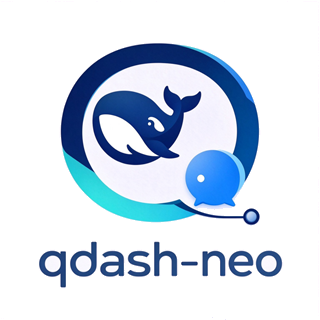

<p align="center">
  
</p>

<h1 align="center">qdash-neo</h1>

<p align="center">将 QQ 群聊与私聊接入 DSH 的聊天机器人插件</p>

<p align="center">
  官方插件：<a href="https://github.com/cmnyhh/qdash-neo-plugins">qdash-neo-plugins</a>
  （语音 TTS、插件开发规范）
</p>

本项目不是独立的机器人框架，而是 [DSH](https://github.com/deepseek-ai/dsh) 的插件。它复用 DSH 的模型、会话、工具与权限体系：收到的 QQ 消息直接进入一次对话，回复由模型自行决定是否发出。

## 功能

- 支持群聊与私聊，通过白名单控制可触发的用户
- **由模型自行决定是否发言**：不发言时不会产生任何输出，不依赖概率拦截
- `@`、称呼名字、拍一拍均可唤醒
- 图片识别（需支持视觉的模型）
- 长期记忆：记录交谈过的人与事，每日自动生成总结
- 角色卡：可指定人设，语气与发言频率均由角色卡定义
- 内置控制台，修改配置无需重启宿主；首次访问时自行设定口令
- 群管理（踢人）为可选项，按 QQ 号白名单校验，默认关闭
- 语音：发语音库里现成的音频；装 `@cmnyhh/qdash-neo-plugin-voice` 后还能把一句话现说出来
- **可扩展**：插件能注册工具、存自己的数据、加控制台页、挂自定义判定器

## 快速开始

### 1. 环境要求

- Node.js 22+
- DSH 0.2.x
- OneBot v11 实现（NapCat、Lagrange.OneBot、LLOneBot 均可）

### 2. 安装

```bash
npm i @cmnyhh/qdash-neo
npx dsh --profile web --patch node_modules/@cmnyhh/qdash-neo/cordis.patch.yml
```

> `--patch` 必须位于 `--port`、`--no-open` 等启动参数**之前**，否则会被解析为子命令选项并报错。

### 3. 配置

打开控制台 `http://127.0.0.1:7800/`（用户名 `admin`）。首次访问会要求**自行设定**控制台口令，之后用它登录；也可在 `cordis.patch.yml` 里预置 `console.password` 跳过这一步。

至少需要填写以下三项：

| 位置 | 内容 |
|---|---|
| 连接 | `onebot.wsUrl`：OneBot 的 WebSocket 地址，如 `ws://127.0.0.1:3001` |
| 连接 | `onebot.token`：OneBot 的 access token（未配置则留空） |
| 触发权限 | `policy.whitelist`：允许私聊的 QQ 号 |

使用群聊时，还需在 `policy.groupWhitelist` 中填写群号。

### 4. 验证

在私聊中发送一条消息即可。

## 发言判断机制

这是本项目与多数 QQ 机器人的主要差异：**默认不会回应每条消息**。

| 情况 | 行为 |
|---|---|
| 被 `@`、被称呼名字、被拍一拍 | 一定会回应 |
| 有人提问（即使未 `@`） | 大概率回应 |
| 他人之间的对话、模型不熟悉的话题 | 由模型判断，多数情况下不参与 |

判断依据写在通用提示词中，**不依赖**回复概率拦截：该消息是否针对自己、此时介入是否合宜。

**发言频率由角色卡决定**。通用提示词只负责判断维度，性格特征写入角色卡；如需调整活跃程度，修改角色卡即可，无需改动插件。

## 配置

以下配置均可在控制台修改，保存后立即生效（标注「需重启」的除外）。常用项如下：

| 配置 | 默认值 | 说明 |
|---|---|---|
| `agent.model` | `deepseek-v4.1-flash` | 使用的模型 |
| `agent.reasoningEffort` | `high` | 思考强度 |
| `policy.groupTrigger` | `agent` | 群消息触发方式：`agent` 每条交由模型判断 / `mention` 仅回应 `@` / `judge` 先用小模型筛选 |
| `policy.replyChance` | `0.95` | 通过触发判断后的再次抽样概率，`1` 表示不抽样 |
| `memory.enabled` | `true` | 长期记忆 |
| `proactive.enabled` | `false` | 允许模型排期后主动发言（默认关闭，详见下文） |
| `voice.enabled` | `false` | 允许发送语音（默认关闭，详见下文） |
| `tools.qqAdmin` | `false` | 群管理能力，**开启后还需配置 `tools.adminOwners` 方可生效** |

### 主动发言

默认**关闭**。开启后，模型可在认为「稍后值得再说」时安排一次延后评估（`[[LATER:30]]`）；到期后重新判断，可以选择不发言。

夜间时段为硬性限制：`proactive.quietHours` 默认 `23:00–07:00`，该时段内即使排期到期也不会唤起。另有 `proactive.maxPerDay` 限制每日次数。

### 语音

默认**关闭**，分为两层：

**底座（主包自带）**：将音频文件（`.mp3` / `.silk`）放入 `voice.dir`（默认 `<DSH_HOME>/qdash-voice`），模型即可通过 `qq_send_voice` 发送。仅允许库内文件，并受体积与频率上限约束。

**TTS（需另装插件）**：`@cmnyhh/qdash-neo-plugin-voice` 提供 `qq_speak({ text })`，将文本合成为语音。该插件仅负责产出音频文件；发送、路径校验、限流与落库仍由主包完成。

```bash
npm i @cmnyhh/qdash-neo-plugin-voice
```

开启后由模型**自行判断**使用文字还是语音：多数情况下使用文字；语音仅用于「一两句话即可说完、语气比字面更重要」的场合，例如道晚安、调侃、感慨。

TTS 支持三种接口形式，在插件的 `cordis.patch.yml` 中配置（`tts.protocol`）：

| 值 | 请求 | 适用 |
|---|---|---|
| `openai` | `POST {endpoint}`，body 为 `{model, input, voice, response_format}` | 兼容 `/v1/audio/speech` 的服务 |
| `gpt-sovits` | `POST {endpoint}`，body 为原生 `/tts` 接口格式 | 本地 GPT-SoVITS（另需填写 `refAudioPath` / `promptText`） |
| `custom` | 由 `bodyTemplate` 替换 `{{text}}` 生成 | 非标准端点 |

合成结果按内容与音色缓存，相同文本不会重复合成。TTS 不可用时，模型会改用文字表达相同内容，不会因此丢失回复。

## 远程访问控制台

控制台默认只监听 `127.0.0.1:7800`，**本机以外不可达**。这是有意的：它能改白名单、OneBot 凭据和群管理权限。

需要远程访问时，用下面两种方式之一，**不要**直接把 `console.host` 改成 `0.0.0.0`（等于把改配置的入口暴露到公网）。

### 方式一：SSH 隧道

```bash
ssh -L 7800:127.0.0.1:7800 user@your-server
```

然后在**自己电脑**的浏览器打开 `http://127.0.0.1:7800/`。不需要改任何配置。

### 方式二：反向代理

以 nginx 为例：

```nginx
location /qdash-neo/ {
    proxy_pass http://127.0.0.1:7800/;          # 结尾的 / 会剥掉前缀
    proxy_set_header Host $host;                 # 必须传：Host 白名单靠它
    proxy_set_header X-Forwarded-Proto $scheme;  # 必须传：HTTPS 下 cookie 才带 Secure
    proxy_set_header X-Forwarded-For $proxy_add_x_forwarded_for;
}
```

然后访问 `https://example.com/qdash-neo/`。

`console.allowedHosts` 默认是 `['*']`（放行任意 Host），所以反代**不需要额外配置**。

**`X-Forwarded-Proto` 必须传**：少了它在 HTTPS 下 cookie 不带 `Secure`，浏览器可能拒存，表现是「登录成功但立刻跳回登录页」。

**`X-Forwarded-For` 也要传**：登录失败限流按来源 IP 计数。反代之后所有请求的来源都是 `127.0.0.1`，不传这个头的话，一个人输错几次就会把**所有人**锁在外面。

> `allowedHosts` 这层原本防的是 DNS rebinding（恶意站点把自己的域名解析到 `127.0.0.1`）。默认全开是为了免配置，代价由两道兜住：控制台有口令，且首次设置的提交会校验 `Origin`。如果你有固定域名，把它填进去可以恢复这层防护。

## 常见问题

**发言过少？**
先查看控制台中的会话记录。若 `withheld` 持续增长，说明模型已生成内容但未调用发送工具，属于「决定不发言」，并非故障。如需提高活跃度，请修改角色卡。

**发言过多？**
降低 `policy.replyChance`（硬性限制），或在角色卡中明确说明发言偏好。

**无法识别图片？**
需要支持视觉的模型，请将 `agent.model` 改为相应模型。

**控制台无法访问？**
默认仅监听 `127.0.0.1:7800`，本机以外不可达。这是有意的，见上文「远程访问控制台」（SSH 隧道或反向代理）。

**更换 `DSH_HOME` 后配置丢失？**
数据库随 `DSH_HOME` 迁移。数据库使用 SQLite WAL 模式，迁移时需同时复制 `.db`、`-wal`、`-shm` **三个文件**；仅复制 `.db` 会导致数据丢失。

## 致谢

本项目受 [qq-bridge](https://github.com/Derpyu520/qq-bridge) 很多启发，在此致谢。

## 许可

MIT
